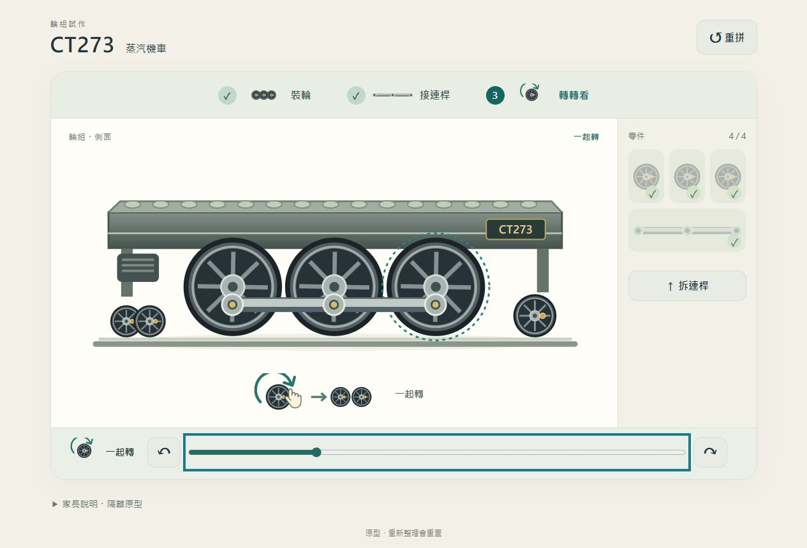

# CT273 大輪與連桿試作

任務正本：[Issue #205](https://github.com/huansbox/aiden-study/issues/205)。承接已發布的 E500 圖形工坊 [#204](https://github.com/huansbox/aiden-study/pull/204)；E500 比較原型 [#202](https://github.com/huansbox/aiden-study/pull/202) 保留。

## 要回答的問題

車款的機構能否讓拼裝過程有不同感受？本次只驗證「三個輪子各自轉 → 接上連桿 → 三輪一起轉」。觀察家長與 6y／9y 能否看圖操作、看出接合造成的改變，是否有別於 E500 的底盤試推。實作及技術驗證完成不等於主觀體驗已確認。

## 啟動與操作

在本分支的 repo 根目錄執行：

```sh
uv run python -m http.server 8796 --bind 127.0.0.1 -d docs
```

開啟 <http://127.0.0.1:8796/parent/ct273-lab.html>。這是本機入口；`127.0.0.1` 不供另一台 iPad 存取。

1. 三個大輪可任意順序裝上：拖零件到金色目標，或先選零件、再點目標／「接上」。
2. 已裝的輪子可沿圓周拖動；也可選輪後操作滑桿／左右旋轉按鈕。鍵盤聚焦輪子時用方向鍵，每次轉 15 度。
3. 三輪裝齊後拿起連桿，三個偏心接點會自動對齊，保持容易接合。裝上後轉任一輪，三輪與連桿同步。
4. 「拆連桿」保留輪子，恢復各自轉動；「重拼」全部拆下。Esc 或「放回」取消拿取。

輪子只隨手動操作移動，沒有自動播放或過關獎勵。系統 reduced motion 或家長說明內「減少接合動畫」會省略零件飛入；圖形和接合後狀態仍可見。



## 來源與界線

- `docs/parent/ct273-lab.html`／`.css`／`.js`：獨立 SVG 圖形介面與互動。`ct273-mechanism.mjs`：三輪和單側連桿的運動關係。
- 輪距採既有 `scripts/e500-art/model-ct273.js` 的等距三輪（144、218、292）比例，沿用八輻條、深灰與黃銅接點的造型概念，重新畫成可互動的側面機構示意。未替換正式透明 PNG。
- 三輪保持同相位；三個輪上的偏心點繞各自輪軸運動。連桿維持固定長度及水平姿態，跟隨偏心點平移，沒有整支繞輪心旋轉。這只表示耦合關係，不是完整 CT273 的雙側配汽、活塞或動力模擬。
- 所有進度僅存頁面記憶體。沒有家庭 API、collection、身份參數、localStorage／IndexedDB、獎勵或發包；CSP 的 `connect-src 'none'` 額外限制網路連線。重新整理歸零。
- 本輪是四件機構小段落，沒有決定正式 14 包的順序、改動 stable IDs，或遷移孩子半成品。正式化仍需另定素材、分包及相容方式。

## 2026-10-13 驗證

- 機構測試：三輪獨立／同步／拆桿、多圈正反轉、固定桿長與偏心點對齊、角度跨 ±180 度接縫。
- 事件回歸：Esc、pointercancel、lostpointercapture 後的原生 click 不重拿零件，取消後可重試，鍵盤選件及 reduced motion 安裝可用。共五項新增測試。
- 瀏覽器實際操作：3→1→2 任意順序裝輪；點選、目標點按、Enter、真正拖輪到輪軸、錯誤落點放回、取消、接合中重拼；連桿以拖曳接上，沿輪緣手轉可帶動三輪，鍵盤／滑桿／旋轉按鈕與拆桿比較皆可用。
- 實測獨立輪角度 `[0,90,0]`；接桿後 `[90,90,90]`；拆桿再轉單輪 `[75,75,345]`。拖曳連桿後手轉亦確認三輪角度同步，桿位置隨接點更新。
- 桌面、1024×768、768×1024、390×844 viewport；直向採下方零件盤，窄螢幕階段圖示不擠壓文字，沒有橫向溢出。瀏覽器 console 無 error／warning。
- 手動 reduced motion 路徑實測；獨立 agent review 已完成，取消事件候選已修正並以回歸測試核對。最新 CI／完整測試結果記於 Issue／PR，避免這裡另存易過期的交付狀態。

尚待試玩：實體 iPad 的觸控與作業系統動態偏好、6y 是否能自主理解、與 E500 相比的組裝差異感。尚未驗證長期新鮮感，也沒有合併／發布至正式站。
