# 每日目標與拼裝收藏

主規格 [#110](https://github.com/huansbox/aiden-study/issues/110)，實作拆分為每日目標 [#111](https://github.com/huansbox/aiden-study/issues/111)、拼裝 [#112](https://github.com/huansbox/aiden-study/issues/112) 與整合驗收 [#113](https://github.com/huansbox/aiden-study/issues/113)。

目前狀態：每日目標與臺鐵三車已透過 [PR #114](https://github.com/huansbox/aiden-study/pull/114) 發布至[正式網站](https://kids.linshuhuan.com/)，家長試拼由 [PR #121](https://github.com/huansbox/aiden-study/pull/121) 補齊，700T／N700S 由 [PR #127](https://github.com/huansbox/aiden-study/pull/127) 發布。EMU900、藍皮解憂號與 CT273 的最新交付及發布證據見 [#197](https://github.com/huansbox/aiden-study/issues/197)；下列使用說明涵蓋八款。歷史驗收紀錄保留當時狀態。

## 目前規則（2026-10-20）

[#216](https://github.com/huansbox/aiden-study/issues/216) 第一階段先開放 E500、CT273、藍皮客車，並隱藏其他未完成重設計的車款。[#217](https://github.com/huansbox/aiden-study/issues/217) 的 release candidate 已加入 EMU3000、EMU900、700T、N700S，新選名單共七款；正式發布與內容核對仍以該 Issue 為準。R200 本輪不重做，也不提供新選。未擁有圖鑑、確認選車與收齊目前開放系列都使用同一名單。已有任何車款的半成品、完成收藏和展示完整保留，不退包、不改 ID 或包數；家長的獨立記憶體試拼仍保留全部歷史模型。

新作品依 [#213](https://github.com/huansbox/aiden-study/issues/213)／[#214](https://github.com/huansbox/aiden-study/issues/214) 使用 `contentVersion: 2`，展示鐵軌是固定場景，不消耗拼裝包；從輪組／底盤開始。E500、CT273 各 13 包／39 組，其他五款開放車各 11 包／33 組。舊 `contentVersion: 1` 或未標版本的半成品仍依原包數接續，既有完成收藏不改寫。下方依日期保存的歷史驗收段落描述當時版本，不能當成目前包數。固定場景、圖片載入與縮圖量測見 [工作台效能與驗證](workshop-performance.md)。

四款新工坊沿用原 LEGO style 分件素材：EMU3000 組車頭與燈組後試亮、EMU900 組雙扇門後反向開合、700T 比對鴨嘴分層並試拆檢修蓋、N700S 比對中央與雙翼。這些是玩具零件觀察互動；試玩不寫進度、不耗包。完成卡與收藏室提供「玩玩零件」，唯讀回看已完成作品後回到原畫面，不重新慶祝。操作與驗證界線見 [EMU 工坊](emu-workshop.md)及[高速列車工坊](highspeed-workshop.md)。

每日必做完成後，原卡保留「已完成」，孩子可自行點「加碼再做 N 題／輪，可再得 1 包」進入原活動；不自動開始下一輪。每完成相同份量多得一包，不限次數，例如自然 20／40／60 題各一包。獎勵照舊只在回合或批次結束提示。

## 使用方式

家長後台的「孩子設定與練習 → 每日目標與拼裝包」提供「火車試拼」，開啟獨立的 [試拼頁](../docs/parent/train-preview.html)。八款車都能從第一包開始，逐包試到完工；也能直接保留最後一組，試拖曳、六秒慶祝、音效、略過、重播及示範展示架。從家長入口開啟後，返回時保留原本管理的孩子。

試拼頁只掛記憶體 adapter，沿用正式工作台與素材，不載入家庭登入、收藏 client 或同步程式，不讀寫家庭 API、localStorage／sessionStorage，也不消耗任何孩子的拼裝包。頁面的 `connect-src 'none'` 另阻擋 API 連線。切換模型、重新開始或重新整理會重置示範進度；離開／結束／重設會停止音效及動畫。入口 `docs/parent/train-preview.html`，行為在 `train-preview.js`；共用工作台的 `preview` 選項只調整試拼文案，孩子版預設不變。

家長後台的「每日目標與拼裝包」設定一次活動和份量，每天按臺灣日期重新計算。題庫數學預設建議 10 題，英文建議一輪；按儲存後才生效。新增活動不會自動加進每日必做量，孩子仍自行選內容，不指定單元或複習。

每完成設定的一份目標得到一包；必做完成後可自選不限次加碼，每再完成同份量多一包。不同活動與兩個孩子使用各自設定的份量。沒有安排目標時，自由練習完整一輪仍每日只有一包。重送同一作答或回合不重複計算。數學題庫是 `study:math`、長除法是 `math`，英文拼字和 Native Camp 各自計算。

若某活動沒有可練內容，家長可取消該目標或調整份量，儲存後立即生效。當日已練進度與已領包保留；取消或清空不加發。當日已領包抵扣目前各目標 `floor(累積進度 / 份量)` 的合計，只有合計超過已領數才發差額；調大份量或減少目標不收回已領包，取消再加回、重複儲存不重複發包。調小份量可能補當日差額。調大份量或刪目標後，舊已領包可能抵扣後續進度；首頁依「只練這項活動」顯示距離下一包的實際剩餘數，不將完成份數當成實領包數。例如自然 20 題已做 45 題、領 2 包後改成 30 題，還需 45 題，到 90 題才有下一包；另一科達標會同步減少抵扣差額。舊規則當日的 `first`／`all`／`goal` 包也算入已領數，上線當天可補當日差額；過去日期不因讀取或新規則上線補發。2026-10-19 起的新日期使用 `rewardVersion: 3`，離線首次跨日補送仍按原練習日期的份量計算；已存在的舊日 v1／v2 照其原規則。

首頁「還有 N 包可以拼」直接開啟工作台，計入所有日期尚未拼完的包；「今日拼裝包」仍只計今天獲得的數量。收齊所有現有車款後，額外包改顯示保留在零件盒，不承諾立即可拼。

「我的成果」分為「我的收藏／拼裝包紀錄／學習紀錄」。拼裝包紀錄依發包日期列出獲得數及各包狀態：未拆開、已分配待拼、拼裝中（已放幾組）、已拼好；首頁也有直接入口。日期是獎勵歸屬的臺灣日期，狀態是目前的使用狀況，既有資料沒有逐包拆開或拼好時間，不能據此推定何時使用。紀錄直接讀取既有 grants 與零件位置，不補發、不改分配；离線時標示為這台裝置保存的紀錄。追蹤 [#199](https://github.com/huansbox/aiden-study/issues/199)。

學習紀錄保留今日、累計、活動明細及八個里程碑。收藏內的工作台支援點零件再點空位、或拖曳靠近吸附；稍後再拼會保留各零件位置。收藏室同頁顯示展示架與系列內容。

收藏圖鑑統稱「積木列車收藏」：七款開放新作合計 81 包、243 組。收齊七款就把額外包保留在零件盒，不要求取得已停止新選的 R200。八款歷史模型資料仍保留；既有 v2 的 E500、CT273 各需 13 包、39 組，其餘車款各需 11 包、33 組；舊 v1 仍各需 14／12 包、42／36 組。每包三組可操作部件；每天完成四種目標時，約三至四個達標日完成一件，漏日不扣除成果。每組由多顆積木組成，並非要求孩子每次只放一顆最小積木。各模型保留自身系列名稱，避免把日本新幹線歸為臺灣火車。

## Collection 資料契約與退包維護

`CollectionCore.AVAILABLE_MODELS` 是孩子新選的唯一名單，`isModelAvailable(modelId)` 供工作台與 Worker 共用；`MODELS`、`MODERN_MODELS` 及模型 `get()` 仍包含所有舊作品。限制只套用於新建 build；既有 active 同款可確認與接續，成功命令仍先依 SQLite command ID 去重。尚未送達的未開放新選回傳 409 與「尚未開放新選」，client 清除 pending 並保留錯誤，讓孩子重選開放作品。

`PACK_COUNTS`、既有 v1 的 grant `packIndex`、part ID 保持不變。新 v2 的 `packIndex` 從 1 開始，直接對應原本的 `model.steps[1]`／`p2-*`；後續仍是原 `p3-*`，沒有重新編 part ID。畫面第一包使用 `packNumber(build, index)` 顯示；`packStart(build)` 為 v2 的 1／v1 的 0，`packCount(build)` 回傳實際所需包數，`requiredParts(build)` 回傳 `{id, packIndex}`，完成判定只認這份清單。新建 `build.id` 含 `commandId`，撤回後重選同車也不重用 ID。`selectionGeneration` 在舊資料與空狀態預設 0，每次成功建立新作品及撤回作品各加 1；新 client 選車帶 `expectedSelectionGeneration`，舊 client 未帶則視為 0。練習新領包只增加一般 revision，不改選車世代。未曾送達的舊選車命令在撤回後會被 409 拒絕；已成功命令仍由 SQLite 先去重。

待確認選車以 outbox 保存同一命令；`snapshot.pendingSelection` 提供 `{modelId, commandId}`，暫時連線失敗的例外帶 `code: "selection-pending"` 與相同資料。工作台顯示等候連線與重試，不提供會被誤認為取消的返回／換車。明確拒絕後清除待送選車、讀回最新選車世代，同時保留錯誤訊息，讓下一次重新選擇可正確提交。

退包是一次性維護命令 `release-build`，不放在孩子 UI。命令帶 `expectedActiveBuildId` 與 `expectedRevision`，只撤回當前未完成作品；其所有已拼完整包、部分包、已配未拼包一併回到零件盒，保留 grant ID／日期／總數及所有完成收藏。舊裝置補送 `place` 因原 build 已移除而不能復活；SQLite 先依 `commandId` 去重，同一退包重送不影響後來新選的作品。

家長已登入的瀏覽器可直接開 `/parent/collection-maintenance.html?child=aiden`（另一孩子為 `bingpu`）。此頁不掛孩子或一般家長入口：先讀取並核對孩子、車款、完整／部分／待拼包與 grant 總數；下載當下 snapshot JSON，確認檔案已保存後，按「退回目前作品的 N 包並重新選車」。頁面保存同一筆命令身分，回應遺失可重試，再從 API 讀回核對原作品移除、所有原 grant ID／日期／獎勵內容保留；允許期間新領包或孩子另選車、原包重新配給新作品，不要求讀回總數與備份相等，也不對新作品做事。頁面與 CLI 共用 `verifyRelease(before, after, buildId)` 核對，不代孩子選新車。下載內容只含 collection snapshot，不含家庭憑證。收藏若在備份後有新進度，revision 核對會拒絕，需重新讀取與備份。

命令列替代入口：`node scripts/release-collection-build.mjs --snapshot <當下備份JSON>` 預設 dry run。套用另須 `--apply --endpoint <API根網址> --child aiden --expected-build <ID> --expected-revision <數字>`；憑證只從 `COLLECTION_TOKEN` 環境變數取得，不接受命令列或備份中的 token，也不印出憑證。預設 commandId 由孩子和備份內容雜湊固定，重送同一備份仍是同一操作。正式退包需先保存備份，合成驗證不能代替正式讀回核對。

## E500 造型與組裝

2026-09-23 使用者確認「車頭＋一組輪組」的 [實際 3D 小樣](../scripts/e500-art/PROTOTYPE-NOTES.md)，授權依相同比例延伸整台。完整 E500 已改用厚實小磚、明顯凸點、斜坡窗框與玩具輪圈；全車包含雙端車頭、六軸輪組與兩座粗 Z 形集電弓，並已替換工作台與展示架素材。

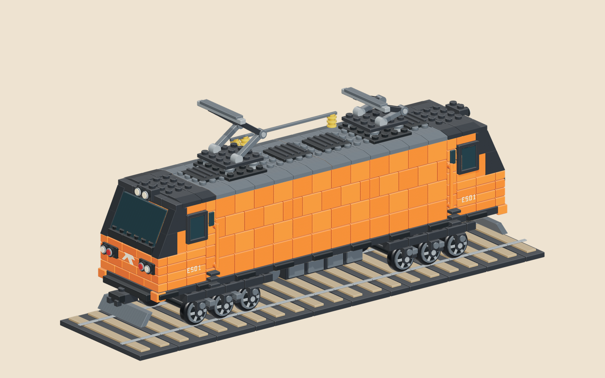

2026-09-23 使用者確認[造型概念](e500-approved-concept.png)後授權接入實際收藏流程。依[東芝 E500 官方設計](https://www.global.toshiba/jp/design/corporate/works/16.html)與[實車照片](https://japan.focustaiwan.tw/travel/202310280003)保留橘色長車身、深灰色車頭窗框、雙端駕駛室、灰色車頂、兩組三軸轉向架與集電弓；E500 是車型，E501 是示例車號。

工作台沿用固定視角，部件本身具有頂面、側面、凸點與接縫；零件盤、拖曳部件、已放置模型與展示架共用同一組素材。42 組各自保存，不以切換整張完成度圖片替代拼裝。概念圖用於確認方向，實際素材以工作台呈現與分組驗證為準。

造型在開發時由 3D 幾何預先渲染成 42 張基本透明 PNG 與 29 張遮擋變體，共約 3.42 MB；正式頁面只組合圖片，不載入 Three.js 或執行 WebGL。同包三組可以任意順序拼，依實際已放置部件選擇變體，避免背面的窗戶與踏階透出。每組按自身範圍裁切，變體共用拖曳與吸附位置，仍只有 42 次操作。重建方式見 [E500 圖像來源](../scripts/e500-art/README.md)。獨立部件之間的互投陰影略有簡化，這份模型也不是實體積木套件的可購買零件清單。

可選模型包含 E500、EMU3000、R200、700T、N700S、EMU900、藍皮解憂號與 CT273；完成一台後可選下一台，收齊目前八台後額外拼裝包繼續保留。舊版小汽車、蒸汽火車與飛機以原 ID、原素材保留既有半成品及完成收藏，不把舊火車進度直接改成 E500；舊客戶端的已支援模型操作仍可接續。

## EMU3000 與 R200

2026-09-23 使用者指定兩台延伸收藏，要求沿用 E500 規格、各 10–14 包；實作各為 12 包、36 組。EMU3000 表現一節含駕駛室的先頭車；R200 表現完整雙端柴電機車。兩台同樣使用 16 單位凸點網格、分段小磚、玩具輪組與固定正交視角。

- EMU3000 依 [Hitachi 官方設計與照片](https://www.hitachi.co.jp/rd/research/design/product/taiwan_tra/index.html)及 [KATO 授權模型](https://www.kato-special.com/emu3000-products-tw)保留黑白車頭、客窗、四軸與車頂空調；此先頭車沒有集電弓。
- R200 依[臺鐵官方首航照片](https://www.railway.gov.tw/tra-tip-web/tip/file/5ef71876-eedc-4139-85f5-cac17191f0cf)及 [R201 實拍](https://commons.wikimedia.org/wiki/File:TRA_R201_on_its_test_run_on_the_Yilan_Line.jpg)保留白色雙端車頭、深藍長側板、白色腰線、六軸及柴油車頂設備；R201 為本模型參照的車號。
- 第 1 包都是展示軌道，第 2–5 包組裝輪軸／底盤／車底，第 6–10 包拼出車身、車頭與車頂，最後兩包補設備及車頭細節。每包完整對照以各自 `metadata.json` 為準。
- 客窗按前後段分組，每組均含鏡頭近側可見部件。兩台的最後一組都集中在前端車鉤／防撞梁，避免跨全車的零散小片讓落點框過大。
- EMU3000 為 36 張基本圖＋28 張遮擋變體，約 2.75 MB；R200 為 36＋27 張，約 3.27 MB。E500 素材與既有 14 包資料保持原樣。共用核心依 `PACK_COUNTS` 分配、驗證包號及判斷完成，首頁和工作台顯示正確分母。

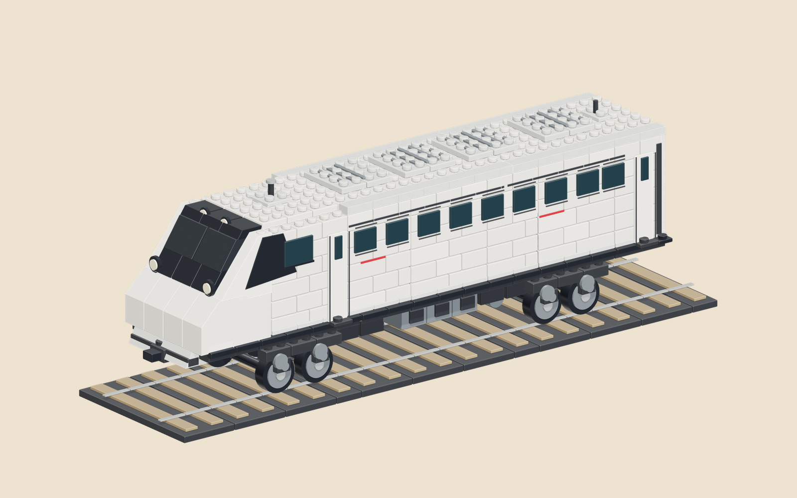

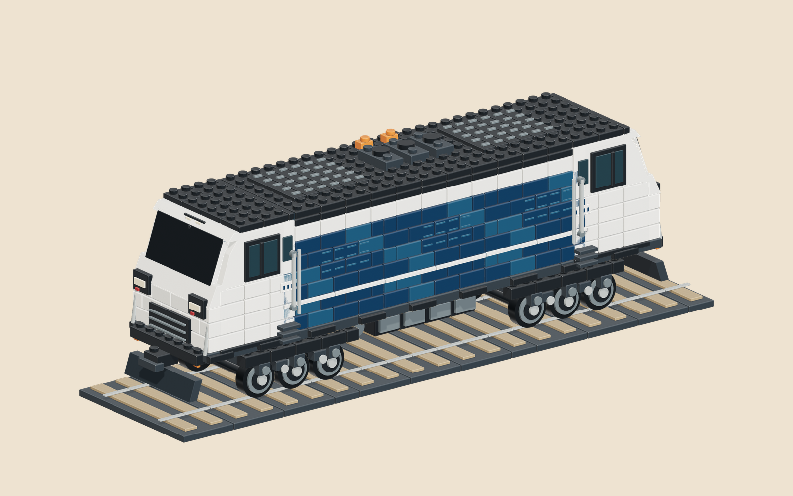

## 台灣高鐵 700T 與日本新幹線 N700S

2026-09-26 使用者指定新增兩台，沿用已確認的小磚風格。兩台均為一節先頭車，各 12 包、36 組；每日完成兩包時約六個達標日拼完。保留明顯凸點、磚縫與玩具輪組，以不同鼻型和配色區分。

- 700T 依[台灣高鐵官方授權模型](https://www.thsrc.com.tw/ArticleContent/4fe8c81c-d66f-472f-90a7-cac6fb4deba8)及[實車車鼻照片](https://commons.wikimedia.org/wiki/File:THSR_700T_frontnose_20130807.jpg)表現短寬鴨嘴、白色車體、橘黑腰帶與深色駕駛窗，採現行經典 700T 外觀。
- N700S 依[JR 東海官方外觀照片](https://railway.jr-central.co.jp/train/shinkansen/n700s/photogallery.html)及[官方設計說明](https://jr-central.co.jp/news/release/_pdf/000034313.pdf)表現較長的雙翼車鼻、白底藍色雙腰帶與車頭側面的藍帶走向；鼻身由多段實心斜磚組成。
- 兩台各有兩組雙軸轉向架；先頭車未加集電弓。照片僅作造型參考，網站使用自行建立的幾何與渲染素材。
- 三段軌道沿用既有尺寸與鏡頭；每組有近側可見部件，最後一組集中在車鼻。收藏、觸控拼裝、音效、六秒試車和家長試拼共用既有流程。
- 模型 ID 為 `700t`、`n700s`。已收齊前三台的孩子可繼續選新車，已領取但未分配的包可接續使用；兩個孩子仍各自選車與保存。

新增車型同時擴充共用 `PACK_COUNTS`，發布時須先部署可接受新 ID 的 Worker，再發布前端；不需要資料遷移或修改已收藏作品。

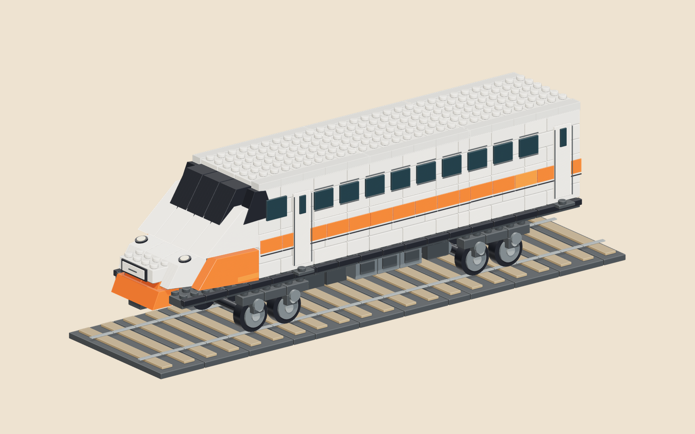

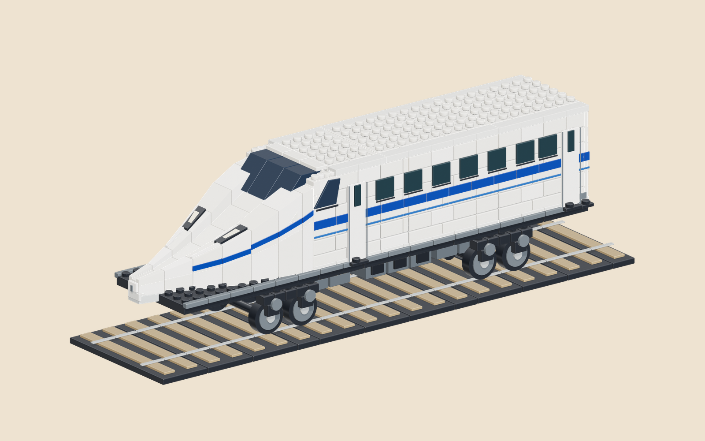

## EMU900、藍皮解憂號與 CT273

2026-10-11 使用者看過外觀小樣後，授權接續製作；範圍與發布狀態見 [#197](https://github.com/huansbox/aiden-study/issues/197)。三款沿用現有固定視角、小磚凸點與軌道，不改每日發包規則。

- `emu900`：一節先頭車，12 包、36 組。依[臺鐵官方介紹](https://www.railway.gov.tw/tra-tip-web/tip/tip00A/tipA11/discountDetl/8ae4cac3754aa62401754f6b9b0e0156)保留銀灰車身、綠色微笑車頭、三組雙開車門及兩組雙軸轉向架。
- `breezy-blue`：一節復古客車，12 包、36 組。依[藍皮解憂號官方介紹](https://www.railway.gov.tw/tra-tip-web/tip/tip00N/tipN01/blue/index)保留藍色車身、米白腰線、八扇銀框開窗、兩端車門與灰色弧頂。
- `ct273`：完整蒸汽機車與煤水車，14 包、42 組。依[臺鐵修復實錄](https://www.railway.gov.tw/tra-tip-web/tip/file/570c896a-63fb-4c5b-91fe-14685cbe203d)保留黑色分段鍋爐、除煙板、三組大型輻條動輪與銀色連桿、前二軸導輪／後一軸從輪，以及煤堆和黃銅號牌。

三款新增 38 包、114 次放置。每組含近側可見部件，最後一組集中在前端車鉤；幾何正本分別為 `model-emu900.js`、`model-breezy-blue.js`、`model-ct273.js`，共用 `train-parts.js`。正式頁面只用透明 PNG；小樣僅供方向參考，不作實體套件零件表。

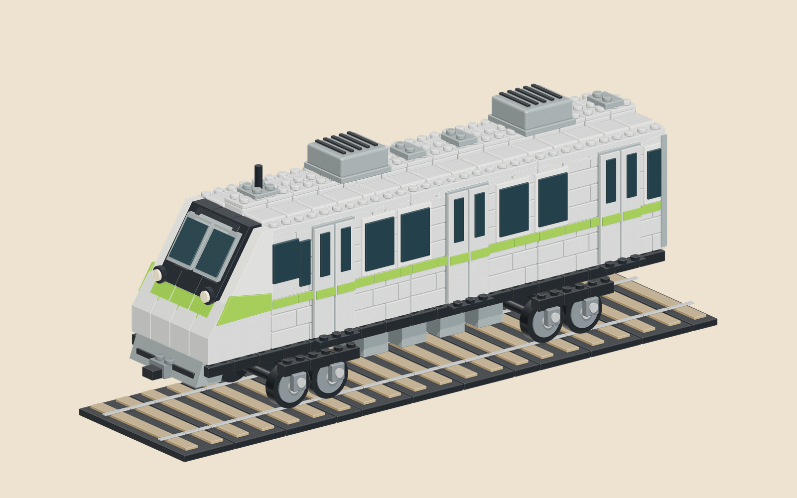

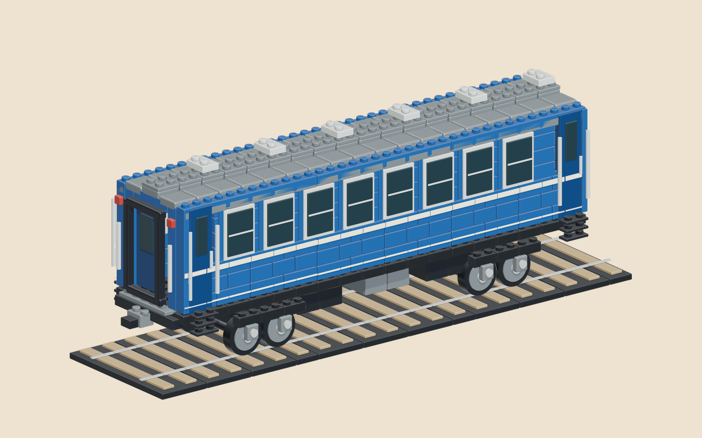

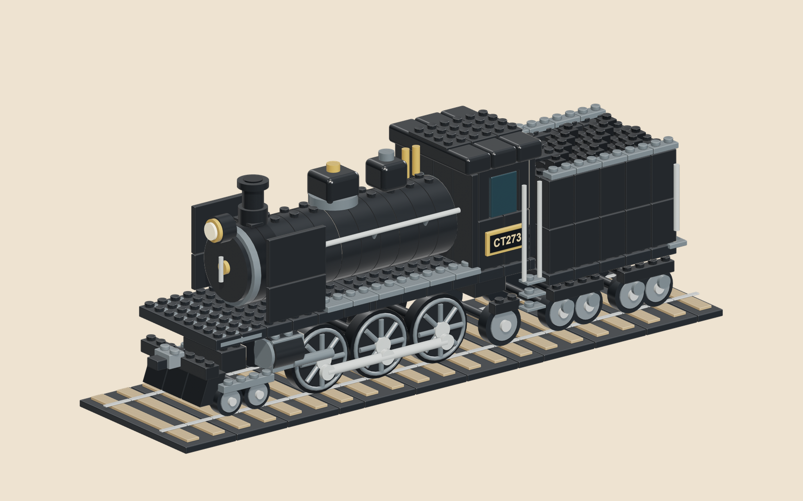

## 完工試車慶祝

本次工作台拼上最後一組，待吸附動畫結束、伺服器確認完成且圖片載妥後，自動播放一次 6 秒試車，八款列車皆支援。沿用正式 LEGO style 圖片，E500／CT273 的 39 組車體、或其餘車型的 33 組車體從右後方進場，經過中央後向左前方駛出，全程單向、不倒退；原本三組展示軌道沿投影方向延伸為九張固定素材，列車駛過時灑下少量彩色小積木。正式頁面仍不使用 WebGL。

最後一組還沒拿起來前，就會在實際放置位置顯示金色外框、箭頭及「最後一片，放這裡」；框可點擊，也涵蓋拖曳吸附範圍。其他部件在選取或拿起時顯示相應提示，拖曳期間不重建 DOM，保留 pointer capture。

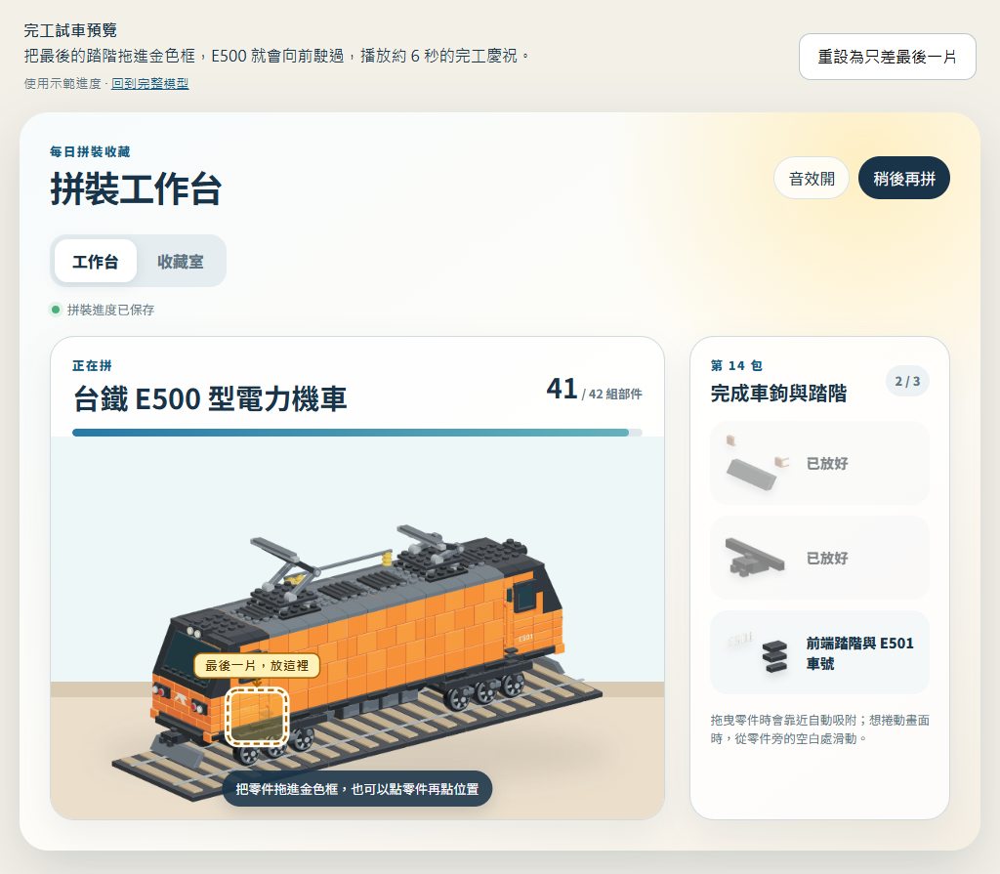

完工搭配柔和上行音階與成功和弦；放置音與慶祝音共用一個按使用者操作啟動的 AudioContext。動畫畫面與工作台均可開關音效；中途重新開啟只接續當下音節，不重播開頭。觸控按下尚未獲得播放許可時，後續放開／點擊會重試啟動。靜音、略過、切頁與銷毀立即清掉已播放及排程音節，不支援 WebAudio 時照常拼裝。

動畫可按「略過動畫」或 Escape 提早結束，回到完成畫面後可「再開一次」；切換收藏室、關閉工作台或銷毀頁面會取消計時。系統開啟減少動態效果時直接顯示完成畫面。重開舊收藏或舊快取更新成另一台裝置已完成的作品，不會自動慶祝；本次離線放完後保持工作台開啟，連線確認完成才播放。

開發預覽服務的 `/celebration.html?model=e500`、`?model=emu3000`、`?model=r200` 提供只差最後一組的示範進度（41／42 或 35／36），可點擊或拖曳最後一組，試看動畫、略過、重播與上架。示範進度只存在記憶體，不寫入家庭資料。

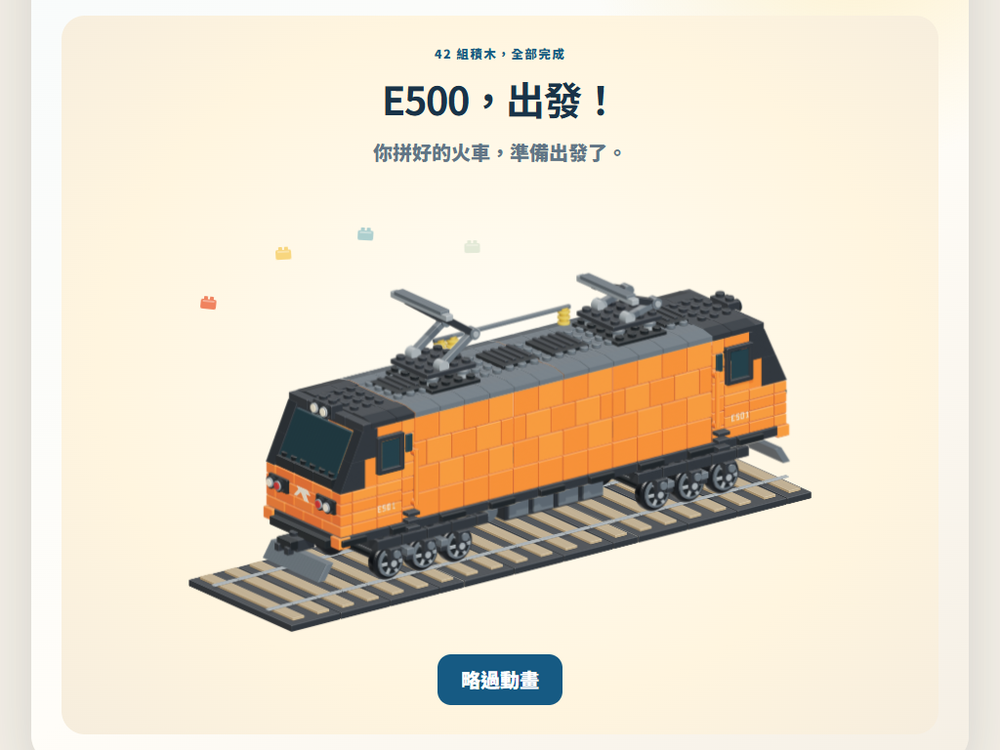

## 保存與同步

- 既有 family activity streams、App progress 與前景計時仍使用原 KV 同步。新收藏不掃描舊累計，不回填舊插畫的擁有紀錄。
- 每個孩子一個 `ChildCollection` SQLite Durable Object，使用同步交易原子保存命令、回合證據與收藏狀態。新目標包以 `date:goal:n` 標示當日第 n 包，空目標自由練習沿用 `date:first`；既有 `date:first`／`date:all` 保留原 ID、分配與零件位置。同包只分配一次，零件放置為集合合併。
- `collection-client.js` 使用逐命令本機 outbox。操作身分固定，回應遺失仍重送同一份內容，暫時性的儲存失敗不清掉待送命令。較舊回應不覆蓋較新 revision。
- 新作答可離線保存，連線後按原日期處理。已分配到作品的零件可離線拼；新選作品與首次分配包需連線確認。完整作品的永久完成與展示等伺服器確認，畫面不把待同步狀態說成已完成收藏。
- `family.beginRound({roundId,entryId})` 只在 App 真正開始一輪時呼叫；`record()` 即時保存，`finishRound()` 只在結果畫面完成回合。暫停、背景與重複完成不增加輪數。回合綁定原作答世代，累計重置後不能用舊回合發新包。
- 累計重置仍依 [activity-reset.md](activity-reset.md) 增加 activity generation。收藏資料不跟著重置，也不把舊活動改標為新世代。

## 實作界線與發布

部署入口改為 `worker/entry.mjs`，匯出既有 Worker 及 SQLite DO class。`worker/wrangler.jsonc` 增加 `COLLECTIONS` binding 與 SQLite migration；正式環境須先部署支援收藏的 Worker，再發布前端。Worker 尚未更新時，新前端清楚提示收藏暫時無法連線，舊練習仍可保存。

前端載入 `collection-core.js`、`collection-client.js` 後載入 family client。首頁另外載入模型、工作台及成果樣式；所有入口的版本參數與首頁 release hash 須隨變更更新。Node CI 先執行 `npm ci` 安裝隔離 runtime，Python checks 沿用 `uv`。

## 可重現驗證

目前使用 Node／SQLite 測試與隔離 fixture，瀏覽器操作使用提供的 CUA browser 工具。本輪 [#213](https://github.com/huansbox/aiden-study/issues/213)／[#214](https://github.com/huansbox/aiden-study/issues/214) 沒有執行 `scripts/verify-collection-e2e.mjs`。

```powershell
npm ci
node --test tests/*.mjs
uv run pytest -q
node scripts/build-brick-previews.mjs --check
node tests/helpers/serve-family.mjs 8817
```

每次瀏覽器驗收使用新啟動的 loopback 隔離服務、`test-token` 與 synthetic 題目／收藏，不接觸正式家庭進度。工坊的延遲、失敗、v1／v2 與最後一片入口、量測方法及本輪數據，見 [拼裝工坊效能與隔離量測](workshop-performance.md)。`/test/bonus-fixture` 提供數學每份 2 題、單元 16 恰兩題（皆為合成選擇題，答案 8），可從原卡自選加碼，連續三批各領一包。

本輪 Node／SQLite 證據在 `tests/test_collection_refresh.mjs`、`tests/test_collection_client.mjs`、`tests/test_brick_workshop.mjs`、`tests/test_e500_workshop.mjs`、`tests/test_ct273_workshop.mjs`、`tests/test_breezy_workshop.mjs` 與 `tests/test_train_preview.mjs`，涵蓋不限次發包、離線補送與退包去重、新舊契約、工坊操作、確認選車、素材失敗重試及隔離試拼。測試通過不能代替實際瀏覽器操作或實體 iPad 驗收。

### 2026-10-19 本輪 CUA 瀏覽器證據

以下皆由主統籌在本機 synthetic fixture 實際操作並讀回狀態：

- 連續三批各 2 題共得 3 包，經原卡自選加碼；用三包選 EMU3000，拼好第一包三組，再放第二包一組。
- 維護頁下載備份並讀回後，退回上述 3 包：1 包完整、1 包部分完成、1 包已分配未拼；grant 總數仍為 3。
- E500 完整 13 包／39 組包含試推、伺服器完成、上架；零餘包仍可選下一台，檢查 EMU3000 確認、返回、CT273 確認。
- 藍皮 v2 從 15／33 到 16／33，先接框再嵌窗扇，開窗至 100；重新載入仍保留 16 組。
- CT273 v2 在 36／39 時，連桿使三輪同步到 90°；試拆後第一輪 105°，另兩輪維持 90°；再用 CUA 實際拖動大輪，第一輪到 194°，另兩輪仍為 90°。
- 390px、768px 視窗的實際 geometry 檢查無橫向溢出；新版流程的瀏覽器 warning／error 為空。

本輪 CUA 拖曳屬實際瀏覽器 pointer 操作，未確認 `pointerType` 為 `touch`，不能宣稱已做 touch input 或實體 iPad 觸控驗收。也未藉這些合成流程證明孩子自主理解、真人操作時間或長期跨裝置使用。

### 歷史 runner

`scripts/verify-collection-e2e.mjs` 保留舊版完整收藏驗收的實作與脈絡；它的 selector、點卡即選、build ID 及 42／36 組假設，已不相容目前的圖形工坊與 v2 契約，不能當作現行完整可重現入口，也不能把下列歷史執行紀錄算成本輪已執行。

該 runner 原設計先透過實際數學與拼字練習領兩包，再用 `/test/collection-fixture` 補過去日期的包，逐件完成八台共 300 組，另檢查另一台裝置、離線重開與 activity generation 重置。歷史無內容情境使用已完成 Native Camp 課程，檢查取消目標保留進度且不補發。各次實際範圍與限制仍以下方對應日期的驗收紀錄為準。

`scripts/verify-daily-goal-rewards.mjs` 已更新不限次加碼預期，但不能只因腳本已更新就宣稱驗收通過；本輪的實際操作證據是上列 CUA fixture 流程，Node／SQLite 證據則由對應測試提供。

## 2026-10-06 每種目標各一包

需求與交付追蹤 [#195](https://github.com/huansbox/aiden-study/issues/195)。每日額度由目標種類數決定；既有收藏、已配包、零件位置及當日進度保留，當天舊包計入額度。Worker 首次讀取當天狀態以交易保存差額；舊日期的延遲作答沿用舊 `first`／`all` 規則，新規則建立的日期跨日補送仍按每種一包。

本機 Node 837 項與 Python 280 項通過，首頁版本與作品目錄檢查通過；隔離 Chromium 六項流程通過，包含四種逐項發包、回合末提示、首頁 4/4、重練不加發與 768px／390px 無水平溢出。這是合成題目與隔離 SQLite DO 驗證，不代表實體 iPad 驗收；正式發布狀態見 issue／PR。

截圖與結果寫入 `.scratch/collection-e2e/`。自動化在 Chromium Pad 尺寸使用真實 touch input 事件；這不等於實體 iPad 或孩子手感驗收。單包 15–30 秒仍是設計目標，不能拿自動化完成秒數宣稱真人已達標。

CDP 測試的 touch drag 按畫面 frame 分送移動，完成後保留 500 ms 手勢間隔。只有靜態色塊與按鈕的獨立對照頁也會吞掉緊接合成滑動的點擊，加入此間隔後恢復；間隔只在驗收 driver，正式介面沒有因此加入固定等待。[Chromium 的 gesture configuration](https://chromium.googlesource.com/chromium/src/+/HEAD/ui/events/gesture_detection/gesture_configuration.h) 另記錄了手勢後的 tap suppression 時窗。

## 2026-09-22 驗收紀錄

- 本機 Node 全套 635 項通過；Python 268 項通過、1 項略過。
- 隔離瀏覽器從空白資料開始，14 個流程檢查全數通過：家長設定、真實數學與英文回合、兩段領包、Pad 點擊／拖曳／取消、稍後接續、收藏室切換、離線重開補送、獨立裝置接續、42 零件完成展示、generation 重置、孩子隔離、原 8 里程碑、下一件作品及無可練內容的目標調整。
- 每日目標核心、工作台與整合各有獨立唯讀審查。已採納回合世代綁定、重複分包、已完成模型重選、鍵盤焦點與首頁／元件導覽衝突等修正。
- 正式環境尚未部署；實體 iPad 與孩子操作時間尚未驗收。

## 2026-09-23 E500 實作與驗收

- Node 全套 648 項通過；本次 Python 268 項通過、1 項略過。模型測試逐張解碼 71 PNG、核對 hash／裁切範圍／網站路徑，並遍歷每包六種順序、共 252 次放置，確認每次都有可見進展。
- 全新隔離服務跑完 [19 條 E2E 流程](e500-e2e-result.json)：從真實數學與拼字練習領包，到 E500 的 42 組拼裝、收藏展示、離線補送、跨裝置與舊蒸汽火車接續。第九包實際依第三、第一、第二組順序拼裝，驗證任意順序選圖。使用 Chromium 1024×768 touch input，另驗證 768×1024 直向畫面沒有橫向溢出；輪組、車身、車頂及車鉤階段均實際拖曳。
- 用瀏覽器阻擋單張 PNG，驗證新拼裝、另一台裝置的已完成作品及收藏室均可顯示錯誤、重試並保留進度。獨立複查已確認：下一包圖片尚未載入時，半成品與最後一組的吸附動畫保留；載圖 callback 不會提早截斷動畫。
- 完整 3D、42 組合成、半成品與任意順序窗組已目視比對，另完成幾何／素材與 runtime 接線的唯讀 review，無未解決 P1／P2。首頁 release 與作品目錄一致性檢查通過；已整合主線自然考卷的完整作品目錄。正式環境未合併／部署，實體 iPad 與孩子單包操作時間仍未實測。

實際工作台（已放 21／42 組）：

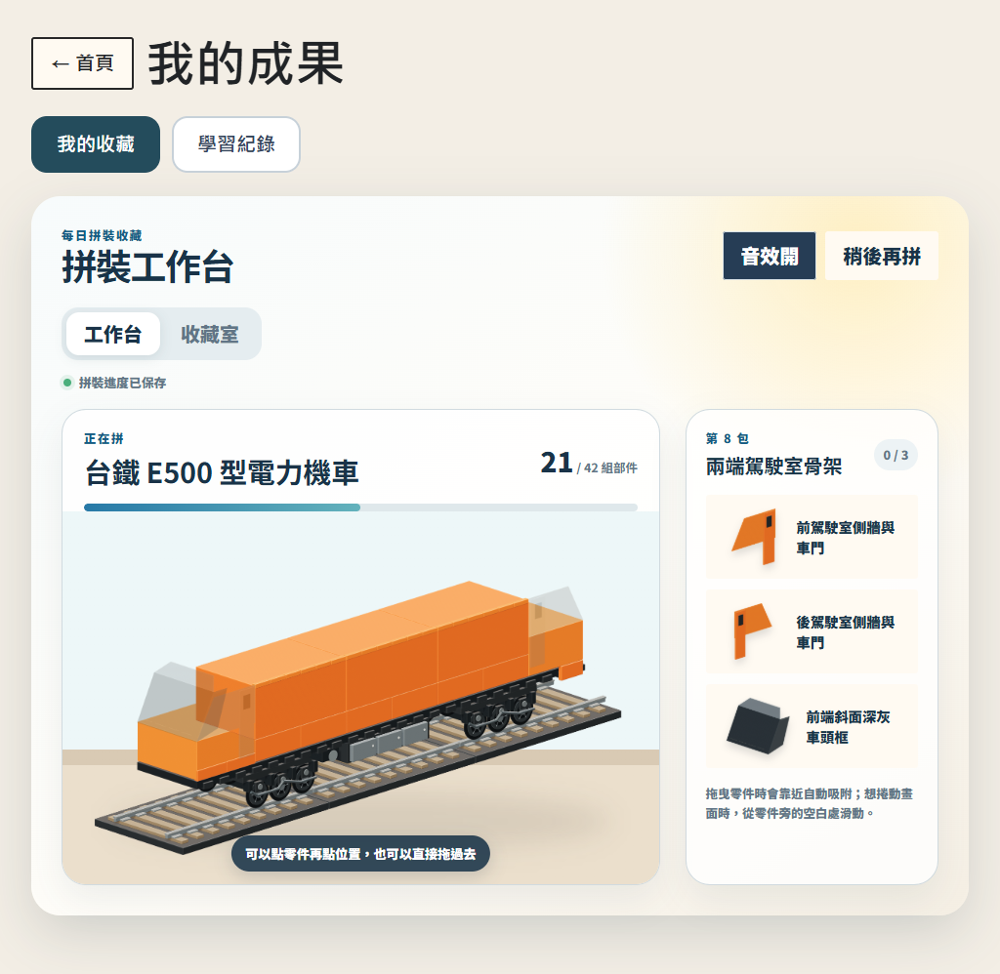

完成收藏與展示架：

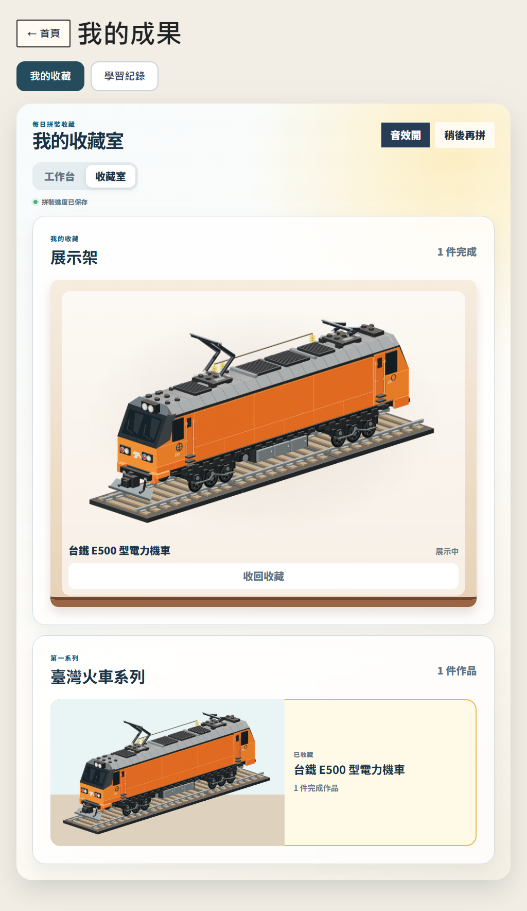

## 2026-09-23 完工動畫驗收

- 已整合主線自然題庫第一批（PR #118），保留既有每日目標與收藏接線。本次 Node 全套 683 項通過；前次 Python 269 項通過、1 項略過，本次未修改 Python。
- 更新後的 [20 條 E2E](e500-e2e-result.json) 全數通過：實際完成 42 組後驗證最後位置提示、延長固定軌道、39 組火車單向移動、六秒自動結束、手動重播、靜音、略過，再上架收藏。另有 [4 條慶祝檢查](e500-celebration-result.json)，用 native AudioContext 與 analyser 實測輸出訊號、靜音清除排程、恢復音效、重播重用 context、直向 Pad 觸控拖曳及中途重設關閉 context。未進行實體 iPad 測試。
- 工作台 42 項與音效 9 項測試涵蓋本次最終放置／伺服器確認、6 秒生命週期、圖片重試、目標框、拖曳節點保留、音效開關與資源清理。既有跨裝置舊快取誤播回歸仍通過；本次修正實際瀏覽器發現的觸控音訊啟動時序，補上 pending resume 重試測試。獨立唯讀複查無未解決 P1／P2。
- 正式環境未合併／部署；預覽與 E2E 均未寫入正式家庭成果。

## 2026-09-23 EMU3000／R200 延伸驗收

- 整合最新主線 `e3bae2fd`（自然題庫 PR #120 與發布文件）後，Node 全套 702 項、Python 271 項通過／1 項略過。首頁版本、作品目錄與連線顯示檢查通過。三台共 198 張 PNG 解碼、hash／裁切／URL 及全部 684 次任意順序放置的可見性檢查通過。
- [23 條隔離 E2E](taiwan-trains-e2e-result.json) 通過：先練習領包完成 E500，再透過真實 UI 依序選擇並完成兩台新車，各 36 組、觸控拖曳、伺服器確認、6 秒慶祝與展示。確認各車首頁從 `0 / 36` 到 `36 / 36`，三台同時收藏、剩餘 1 包保留，學習紀錄重置不刪收藏。
- [EMU3000](emu3000-celebration-result.json) 與 [R200](r200-celebration-result.json) 各 4 條 native WebAudio／Pad 檢查通過：金框觸控點擊、實際音訊訊號、靜音／恢復／略過、重播及直向拖曳；兩台完整模型與最後一組位置已目視檢查。
- 獨立唯讀 review 發現首頁分母固定為 42，已依車型修正並補真實首頁 DOM 驗證；複查無未解 P1／P2。素材分組也修正遠側客窗不可見與最後一組範圍過大的問題。
- 本次結果位於 PR #114，已合併／部署，發布紀錄如下；實體 iPad 與孩子每包操作時間仍未實測。已包含自然題庫 PR #120 與其最終主線文件；合併衝突保留圖表、整組選答與收藏回合接線，獨立唯讀複查通過。另跑 390×844、768×1024、1024×768 的合成自然題組圖表／家長預覽檢查通過。

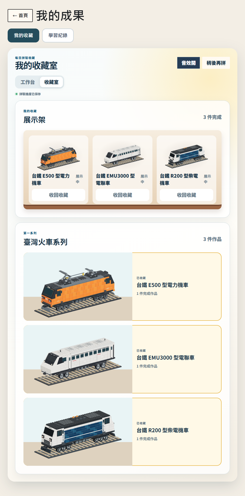

## 2026-09-23 正式發布

- 使用者授權 Land 後，先從已驗收的 `d379de2d` 部署 Worker，再合併 PR #114。Worker 於 18:42（臺灣時間）完成，版本 `6b4c4317-b419-4282-bad0-3c67219ed374` 承接 100% 流量；`COLLECTIONS` SQLite Durable Object 已綁定，沿用原 KV namespace、家庭登入及既有題庫能力。
- PR 於 18:43 合併為 `9ee4e617`；作品目錄自動更新為 `d586293e`。主線 [test](https://github.com/huansbox/aiden-study/actions/runs/35850414900)、[work-catalog](https://github.com/huansbox/aiden-study/actions/runs/35850414649) 與 [GitHub Pages](https://github.com/huansbox/aiden-study/actions/runs/35850440984) 全數成功。
- 18:45 從正式 HTTPS 站逐檔讀取本次 230 個發布檔案（含全部 198 張 PNG，共 10,138,171 bytes），與合併 commit 的 SHA-256 全數一致；自動產生的作品目錄另依最新主線驗證。首頁 release hash 為 `f0692b0072aed5f25bf032ab47bacb53b2f2fab9c6537cca248699309c5d7619`。
- 未登入的 session、收藏與題庫 API 均回傳 401／`no-store`；跨來源收藏寫入請求在授權層回傳 403。正式首頁與家庭連接畫面可正常載入，瀏覽器沒有 JavaScript 錯誤。
- 正式環境檢查未登入家庭或寫入學習／收藏進度。完整領包、114 組拼裝、音效、離線與跨裝置驗證採上述隔離 E2E；實體 iPad 與孩子操作手感仍待實際使用確認。

## 2026-09-23 家長試拼增補驗收

- [10 條隔離瀏覽器檢查](train-preview-e2e-result.json)通過：從家長入口開啟並保留返回孩子；三車任意順序拼第一包、開第二包；EMU3000 實際完成 12 包／36 組並展示；三車最後一組直向 Pad 拖曳、真實 WebAudio 訊號、靜音／恢復、略過、六秒重播及重設。
- 切換車型、結束與重新整理回到示範狀態。試拼期間家庭 API 請求為零；瀏覽器儲存及兩個孩子的隔離收藏狀態完全不變。390×844、768×1024、1024×768 尺寸無頁面橫向溢出；不代表已做實體 iPad 驗收。
- Node 全套原 709 項通過，再補試拼文案回歸後相關 52 項通過；Python 271 項通過、1 項略過。獨立 read-only review 未發現實質問題。此增補另走 PR，與前一節已上線的 PR #114 分開。
- 重現：啟動全新 `node tests/helpers/serve-family.mjs 8841`，用隔離 agent-browser 開本機試拼頁，取得 CDP endpoint 後執行 `node scripts/verify-train-preview.mjs <CDP endpoint> http://127.0.0.1:8841`。

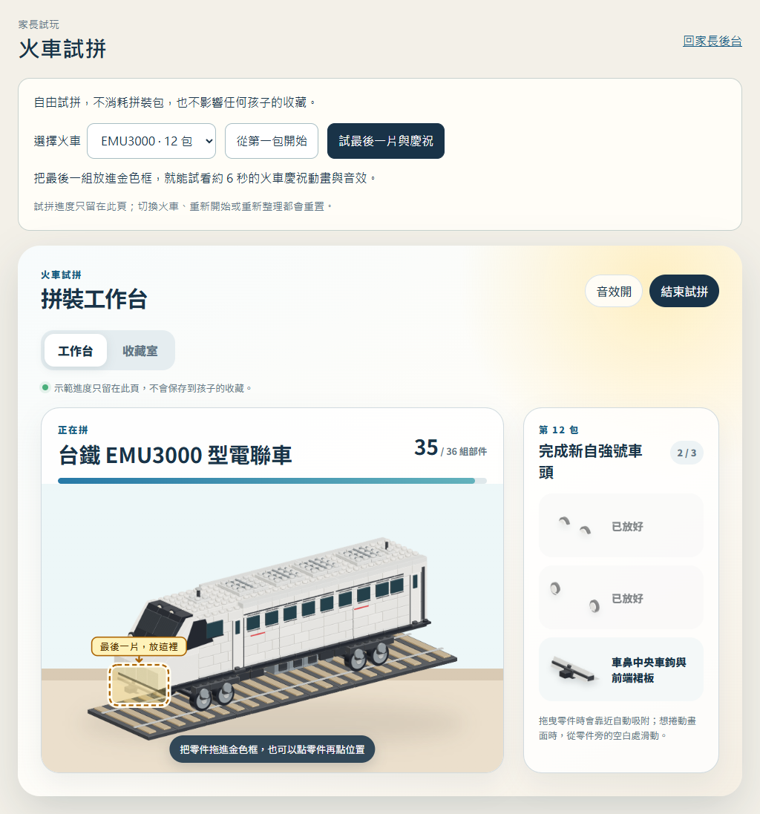

## 2026-09-26 高速列車延伸驗收

- 已整合最新主線 `9965091`，包含自然題庫主題分類 PR #126。Node 全套 730 項通過；Python 271 項通過、1 項略過；首頁版本與作品目錄一致性檢查通過。
- [25 條完整收藏 E2E](highspeed-trains-e2e-result.json)通過：真實數學與拼字回合領包，依序完成五台共 186 組，700T／N700S 各 36 組經觸控操作、伺服器保存、六秒慶祝與展示；剩下 1 包保留。重置學習紀錄仍保留五台收藏，另一個孩子未受影響；直向 Pad 無頁面橫向溢出。
- 700T 為 36 張基本圖＋33 張遮擋變體，N700S 為 36＋35 張，各約 2.80 MB。五台共 338 張 PNG 全部解碼、hash／裁切／URL 檢查通過；每包六種順序共 1116 次放置均有可見變化。兩台鼻端細件經此檢查放大或加上清楚的邊框。
- [700T 慶祝](700t-celebration-result.json)與 [N700S 慶祝](n700s-celebration-result.json)各 4 條 native WebAudio／Pad 檢查通過：最後位置提示、實際聲音訊號、靜音／恢復／略過、六秒重播、直向拖曳及中途重設關閉音效。
- 獨立唯讀 review 檢查新車型接線、舊收藏相容性、來源／素材、階段圖及部件托盤；未留下實質 bug。完整 3D 與實際 PNG 合成已目視比對，修正過鼻燈懸空及軌道末塊超長。
- [14 條家長試拼 E2E](highspeed-train-preview-e2e-result.json)通過：五車任意順序拼第一包、最後一片直向拖曳與真實音效；EMU3000 完整 36 組試拼、切換／重設／關閉／重新整理、390px 與 Pad 排版。試拼過程家庭 API 請求為零，瀏覽器儲存、兩個孩子收藏及測試用學習資料完全不變。
- 本次尚未合併或部署。自動化採 Chromium 的 Pad 尺寸及 touch input；未用正式家庭資料，亦未做實體 iPad 驗收。

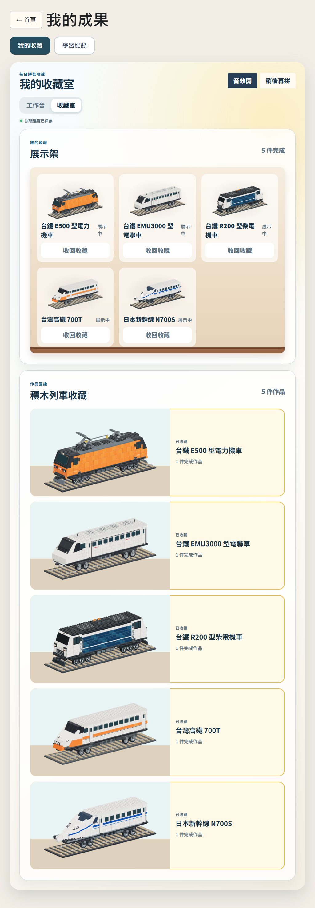

## 2026-09-30 高速列車正式發布

- 整合最新主線 `b3971e6` 後，以 `a94cc95` 完成驗收。Node 全套 770 項、Python 271 項通過，1 項原有略過；重新執行 25 條完整收藏 E2E 與 14 條家長試拼 E2E 均通過，五台共 186 組經隔離 SQLite DO 與實際 UI 操作完成。獨立唯讀 review 未發現實質問題。
- 14:40（臺灣時間）先部署 Worker `aiden-kids-sync`，版本 `c0b46490-a7ae-42b6-8e54-032b60499579` 承接 100% 流量；沿用既有 KV、SQLite Durable Object 與家庭登入，不需資料遷移。14:41 合併 PR #127 為 `9ea93db`，作品目錄更新為 `2131e99`。
- 主線 [test](https://github.com/huansbox/aiden-study/actions/runs/36679538399)、[work-catalog](https://github.com/huansbox/aiden-study/actions/runs/36679538409) 與 [GitHub Pages](https://github.com/huansbox/aiden-study/actions/runs/36679567075) 全數成功。首頁 release hash 為 `9e9b5b4248aaa72d0b31171f9245bbf01851e35a0d8f22eb6944592c5a2c0d4b`。
- 14:49 從正式 HTTPS 站逐檔核對 357 個檔案（含全部 338 張 PNG，共 15,572,387 bytes），SHA-256 均與發布 commit 一致。未登入的 session、收藏與題庫 API 回傳 401／`no-store`；正式家長試拼可載入兩台新車並完成最後一組，N700S 六秒慶祝可正常結束，瀏覽器無 JavaScript 錯誤。
- 正式環境檢查僅使用公開素材、未登入 API 與獨立家長示範頁，未讀寫孩子的學習或收藏紀錄。自動化採 Chromium 觸控；實體 iPad 與孩子單包操作時間仍未實測。

## 2026-10-11 三款臺灣列車驗收

- 新增 EMU900／藍皮解憂號各 12 包、CT273 機車與煤水車 14 包，合計 114 組；現行八款共 100 包、300 組。前三款與高速兩款的幾何、PNG 及既有收藏 ID 均未改動。
- 新增 207 張 PNG：EMU900 36＋32、藍皮 36＋35、CT273 42＋26，合計 9,689,924 bytes。八款共 545 張 PNG 的解碼、透明度、hash、裁切、runtime 一致性及 1,800 次任意順序放置檢查通過。EMU900 前擋風玻璃經像素檢查發現遮擋後，已前移並加窄框，再次驗證通過。
- 本機 Node 全套 859 項通過；Python 279 項通過、1 項原有略過。首頁版本、作品目錄與 Worker dry-run 通過。新增 SQLite DO 測試經真實 Worker API 完成八款共 300 組，重啟後收藏、展示及剩餘 1 包保留，另一孩子未受影響。
- 使用提供的瀏覽器工具，在本機家長試拼逐件完成三款全部 114 組；確認新車名稱／分母、逐包開啟、最後一片提示、完工與慶祝。CT273 最後一組以滑鼠拖曳完成；768px／390px 視窗無水平溢出，重播包含完整 39 組車體。家長試拼仍採原有記憶體 adapter；測試未讀寫正式孩子資料。
- 獨立唯讀 agent review 找到 E2E runner 對藍皮名稱、CT273 慶祝組數的兩處舊假設，已修正並複核；無未解決 finding。原 CDP 全收藏 runner 本輪未執行：命令列啟動測試瀏覽器被自動審查以 blocked by policy 拒絕，改用提供的瀏覽器操作及 Node／SQLite 測試。本輪未重測原有 native WebAudio 訊號、離線多裝置或實體 iPad。
- Worker 已先部署新增車型 allowlist，version `1d5ed40a-4658-4c06-a20a-749dd311bd3f`；前端 PR／Pages 與逐檔核對結果接續保存於 #197。

## 藍皮客車圖形工作台

正式整合追蹤 [#211](https://github.com/huansbox/aiden-study/issues/211)，由已接受的 [門窗原型 #209](https://github.com/huansbox/aiden-study/issues/209) 接續。12 包、36 組、既有 build／grant／part IDs 與完成判定沿用原資料，舊半成品不需要遷移；原本已放好的窗戶或車門直接視為完整組裝。

第 7 包三組窗戶與第 8 包兩組車門，各先接框、再滑入窗扇或門扇。圖解標出目前步驟；窗戶向下滑入後上下開合，車門向右滑入後左右開合。框只是本次工作台內的暫放，接好整組才保存原 ID；切離工作台或重新整理時，尚未嵌入的框需重新接上，已完成組件照常保存。暫放時顯示「接好後保存」，不冒充已存進度。第 8 包端牆及其餘包沿用原零件點接／拖曳。

特寫一次呈現所選的一組窗戶與一組車門，已完成各組可用圖示與數字切換；每組開啟位置獨立。試拆只移開窗扇／門扇，框留在原處，再接回不消耗拼裝包。開合、試拆與回看皆不寫進度；休息、切換全車、重新整理不會減少已存部件。全車按原 36 組圖層呈現，特寫車身不包含未到階段的車頂、輪組或踏階。

操作支援直接拖拉、點接、圖形箭頭／滑桿；鍵盤用方向鍵開合，Home／End 全關／全開，Escape 放回選取。圖片失敗可重試，動畫中離開或中斷不會落下假進度。整組放置仍走既有 collection outbox，因此離線可保存、回線補送，另一入口先完成同組時不重複提交。最後一組仍由既有伺服器確認／慶祝流程處理。

隔離驗證：`node tests/helpers/serve-family.mjs 8801`，開啟 `/test/breezy-fixture` 取得合成的第 7 包半成品；`?stage=doors` 為第 8 包已有後門，`?stage=finish` 為最後一組。入口只在本機測試服務，會重設該服務的 synthetic bingpu 收藏，不能用來處理正式資料。先經家長頁連線，再點「預覽孩子首頁」，從剩餘拼裝包進入。門窗回歸測試在 `tests/test_breezy_workshop.mjs`，素材重建見下列作者說明。
