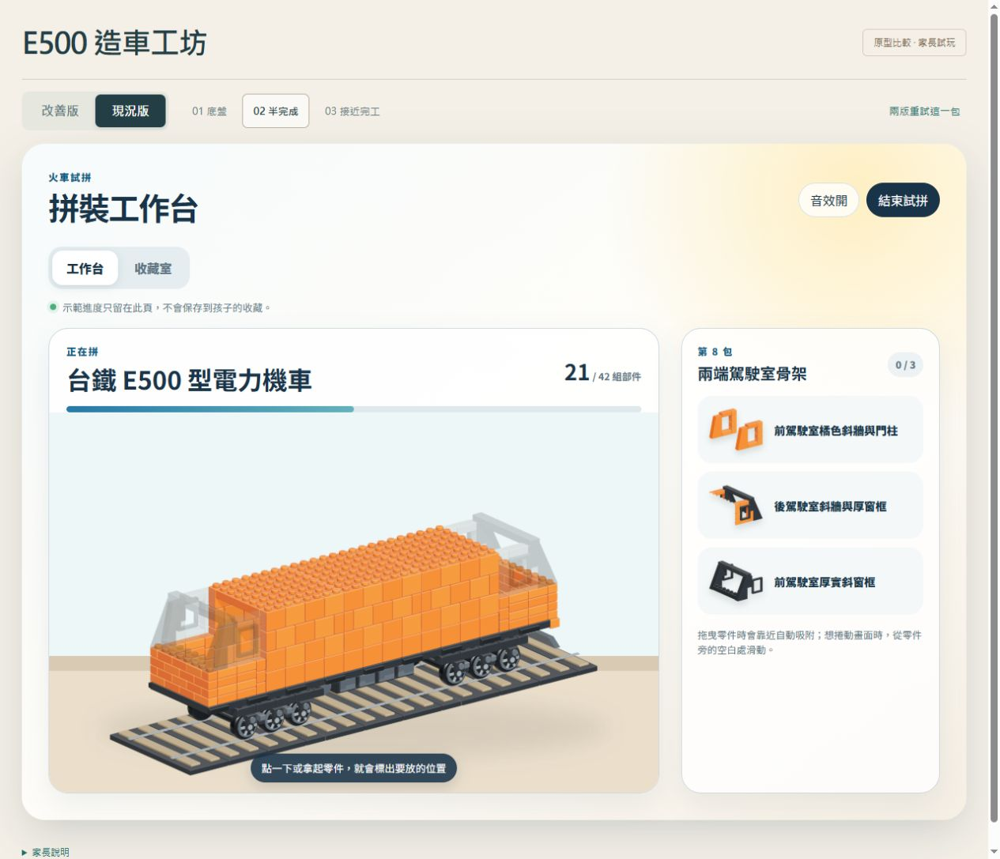
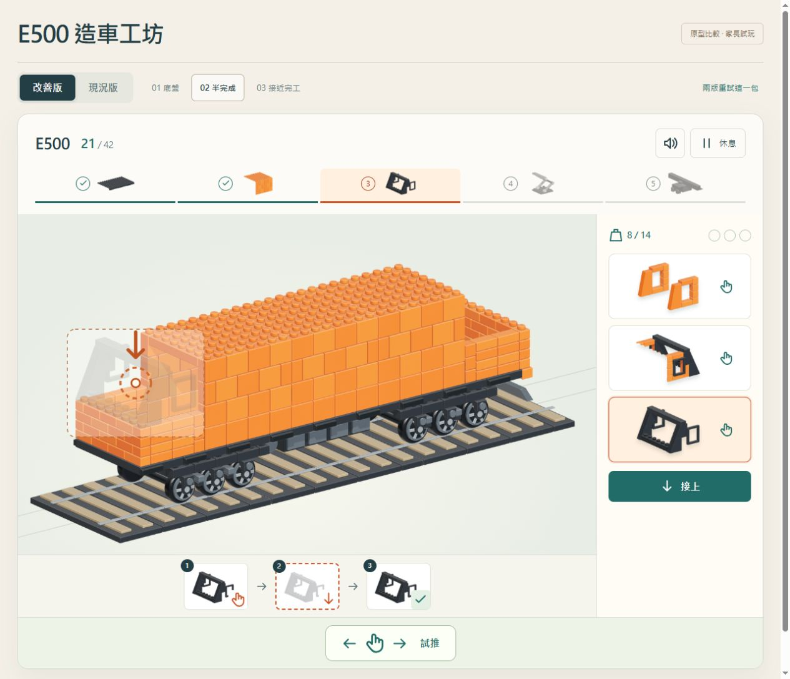
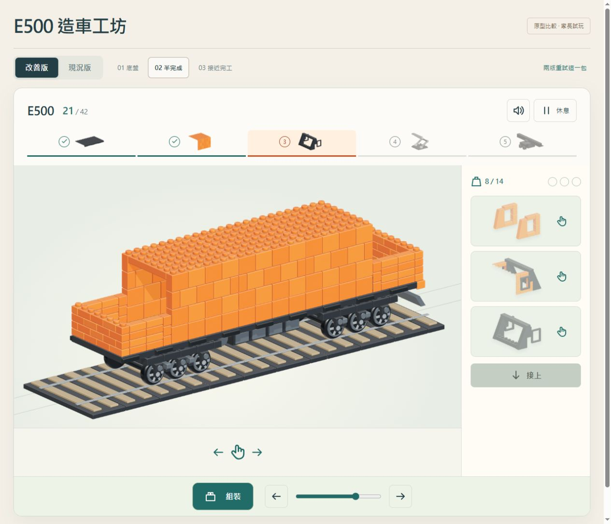

# E500 組裝感比較原型

本輪決策與待決問題以 [Issue #201](https://github.com/huansbox/aiden-study/issues/201) 為準。本頁記錄原型入口與驗證證據；尚未判定能改善長期重複感。

## 如何試玩

以 `docs/` 為靜態網站根目錄，開啟 `/parent/e500-lab.html`。例如從 repo 根目錄執行 `uv run python -m http.server 8791 --bind 127.0.0.1 --directory docs`，再開啟 <http://127.0.0.1:8791/parent/e500-lab.html>。

1. 先試預設的「半完成」：點零件再點接點／接合按鈕，或直接拖曳零件。
2. 切換「現況版」試同一包。兩個版本各自保留進度，「兩版重試」會一起回到相同起點。
3. 完成三組後用「回看／現在」切換；試「休息／繼續」及「試推」。
4. 再看底盤與接近完工，確認不同階段的差異是否容易辨認。

| 起點 | 實際使用的包 | 比較進度 | 要回答的問題 |
| --- | --- | --- | --- |
| 底盤 | 第 4 包，三段承重底盤 | 9 → 12 / 42 | 輪架接成一體，能親手推動，是否有階段成果？ |
| 半完成 | 第 8 包，兩端駕駛室骨架 | 21 → 24 / 42 | 不看百分比，能否看出已造好、剛新增與還缺哪裡？ |
| 接近完工 | 第 14 包，車鉤與踏階 | 39 → 42 / 42 | 最後接合與前後比較是否有完成作品的感覺？ |

## 實作範圍

- 使用既有 E500 的 42 組分件及遮擋素材。現況版直接掛載既有 `KidsBrickWorkshop`，改善版使用獨立介面。
- 放大施工模型，階段以實際部件圖及勾選顯示；完成一包不必然等於完成整個階段。依家長回饋移除完成參考。
- 6y／9y 共用，孩子主要路徑以實際零件圖片、手勢、接點箭頭、三格操作圖與勾選引導。保留「接上／休息／回看／試推」等短標籤及完整 ARIA 名稱；長說明收進家長說明。
- 拿起的零件以模型上的尺寸移動，靠近接點會對準，再接合落位。點按與拖曳都能完成，拖到空白處／Escape 可取消。
- 每個版本、每個起點各有獨立記憶體進度；沒有 family API、登入、收藏儲存或獎勵發包。CSP 阻擋資料連線。
- 「休息」僅保留目前頁面的記憶體。重新整理會重置；不是跨裝置保存功能。
- 試推只把已組好的車體沿軌道方向平移，車輪沒有獨立旋轉或物理模擬。
- 僅比較這三包，沒有實作一整台車的改善版連續流程，也沒有修改正式工作台或首頁入口。

## 2026-10-13 驗證

自動檢查：Node 全套 867 passed；Python 279 passed、1 skipped；catalog `--check` 通過。新增狀態測試涵蓋相同起點、版本隔離、重試、重複落件、錯誤包／零件、快照隔離及不存取正式資料。最後 UI 修正後，相關 22 項與 JavaScript 語法檢查再次通過。

瀏覽器實測：

- 桌面及 768×1024、1024×768、390×844 viewport；沒有橫向溢出。
- 三個起點完成各自三組；鍵盤 Enter、點按、拖曳落位、拖到空白處取消。
- 版本各自保存進度、重試、暫停／繼續、本包開始前／現在切換。
- 接合動畫尚未結束時切換版本，不提交未完成接合的進度。
- 試推按鈕與直接拖動模型，車體位置改變而組裝數量不變。
- 隔離測試伺服器刻意讓一張 PNG 首次回傳 404，顯示錯誤後按「重新載入圖片」恢復工作台。
- 正常入口瀏覽器 console 無 error／warning。

獨立 agent review 發現半完成包結束後階段過早跳到車頂，已改用實際結構界線，也修正回看開始前時的說明文字。未修改共用 production 檔案。

尚待人工驗證：實體 iPad／觸控筆、作業系統 reduced motion 偏好、6y 能否理解圖形指示，以及跨數次使用的新鮮感。reduced motion 已有跳過接合動畫及 CSS 簡化路徑，但本次只檢查實作，未切換實體裝置偏好。

### 圖形引導修訂

家長已回饋「拼的感覺有改善很 ok」，並要求拿掉完成參考，讓不熟文字的 6y 也能與 9y 共用。此輪保留接合動作，將零件名稱、段落說明、階段文字改成實際分件圖片、操作示意與勾選。

修訂後相關 22 tests、語法及 diff 檢查通過；三個起點皆在瀏覽器完成，涵蓋 SVG 接點 Enter、點按、拖曳、回看、休息繼續與版本隔離。768×1024、1024×768、390×844 無橫向溢出，正常入口 console 無 error／warning。獨立 review 發現休息畫面圖示誤套模型 SVG 尺寸，已限縮 selector 並確認圖示恢復 24px。

本機試推實測：預設半完成頁按「試推」，滑鼠按住車身左右拖，車體沿軌道移動、組裝數維持 21 / 42；箭頭按鈕也可用。底盤頁需先接完三組才出現試推。按「組裝」可繼續拼。車輪仍不獨立旋轉，拖動距離有限，屬用途里程碑的最小原型。

## 相同起點畫面

兩張均為 21 / 42；改善版額外選取前端窗框，展示接點引導。

### 現況版

### 改善版

### 試推模式

## 下一個決策

接合手感已獲家長肯定；接著確認圖形版能否讓 6y 少靠大人說明操作，再決定正式版範圍。孩子回饋需跨數次使用，不以一次「喜歡」判定重複性已解決。正式整合及其他車款需另確認範圍。
